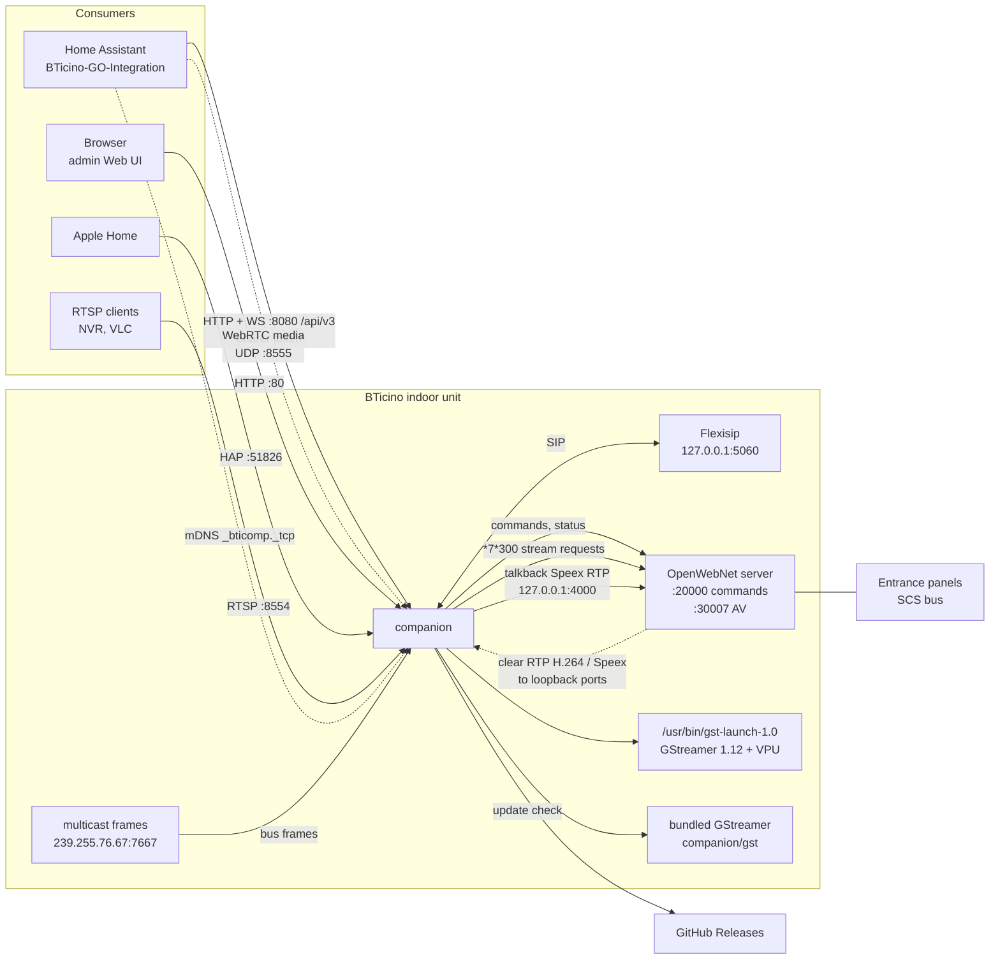
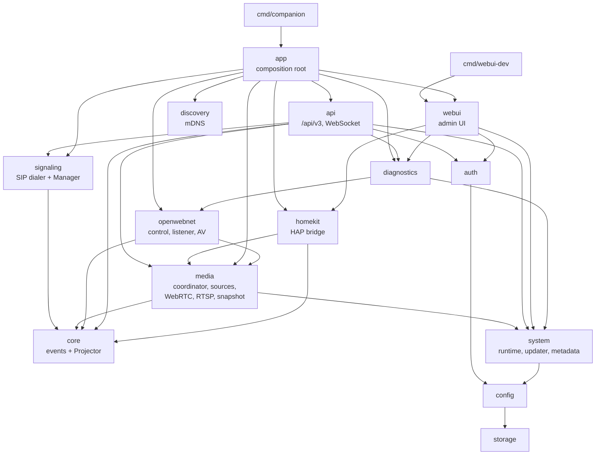
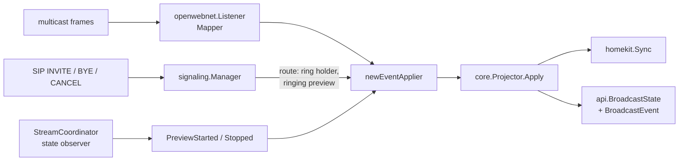
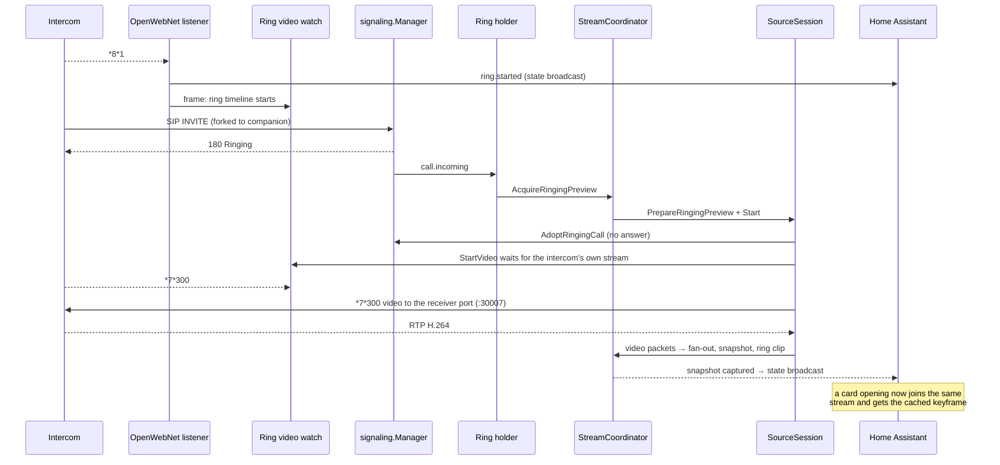

# BTicino GO Companion — Architecture

A single static Go binary ([`cmd/companion`](../cmd/companion)) that runs **on** a rooted BTicino
indoor unit (Classe 300X / 100X, Linux on ARMv7). It speaks the device's own protocols —
OpenWebNet and SIP through the local Flexisip — and exposes the intercom over HTTP/WebSocket,
WebRTC, RTSP and HomeKit. Its main consumer is the Home Assistant integration
([BTicino-GO-Integration](https://github.com/abeilprincipino/BTicino-GO-Integration)).

The companion does not replace the BTicino stack, it joins it: it registers as one more SIP user
so the intercom forks doorbell calls to it, and asks the intercom's AV service for the same RTP
streams the indoor display uses.

Design decisions with their own write-up live in [`docs/superpowers/specs/`](superpowers/specs);
measurements and investigations in [`docs/analysis/`](analysis). This document links to them
where they apply.

---

## 1. System context

| Port | Protocol | Purpose | Code |
|---|---|---|---|
| TCP 8080 | HTTP + WebSocket | Companion API v3 for Home Assistant | [`internal/api`](../internal/api) |
| TCP 80 | HTTP | Admin Web UI and its `/webui/api` | [`internal/webui`](../internal/webui) |
| UDP 8555 | ICE | WebRTC media (single UDP mux port) | [`media/webrtc.go`](../internal/media/webrtc.go) |
| TCP 8554 | RTSP | `rtsp://<ip>:8554/doorbell-<entrypoint-id>` | [`media/rtsp_server.go`](../internal/media/rtsp_server.go) |
| TCP 51826 | HAP | HomeKit bridge | [`internal/homekit`](../internal/homekit) |
| UDP 5353 | mDNS | `_bticomp._tcp` advertisement for discovery | [`internal/discovery`](../internal/discovery) |
| 127.0.0.1:20000 | OpenWebNet | Commands and status (unlock, mute, voicemail, diagnostics) | [`openwebnet/client.go`](../internal/openwebnet/client.go) |
| 127.0.0.1:30007 | OpenWebNet AV | Asks the intercom to stream RTP to a port | [`openwebnet/av.go`](../internal/openwebnet/av.go) |
| 239.255.76.67:7667 | UDP multicast | Every bus frame the intercom sees | [`openwebnet/listener.go`](../internal/openwebnet/listener.go) |
| 127.0.0.1:5060 | SIP | Flexisip: REGISTER, inbound and outbound calls | [`internal/signaling`](../internal/signaling) |

The firewall rules for the inbound ports are installed by [`scripts/install.sh`](../scripts/install.sh)
and reopened by the init script at every start.

---

## 2. Packages

Everything lives under `internal/`, module path `bticino-go-companion`. The graph below is the
real import graph (`go list`), with `app` as the only package that sees everything.

Rules that the graph encodes and that should stay true:

- **`core` imports nothing internal.** It is the vocabulary (events, state) every other layer speaks.
- **`signaling` depends only on `core`.** It knows nothing about media; media borrows its dialogs
  through small interfaces (`media.SourceSIP`).
- **`openwebnet` imports `media`, not the reverse.** `AVClient` implements `media.SourceAV`, and
  `media` defines the interfaces it needs (`SourceAV`, `FlowProbe`, `AVPorts`).
- **Nothing calls back into `app`.** Cross-package wiring (who publishes events to whom, who is told
  about a hangup) is done in [`app/run.go`](../internal/app/run.go) with closures and `Set*` methods,
  which is why `api.Server` and `homekit.Manager` can be tested without a device.

`logging` and `httputil` are leaf helpers. `media/distributor.go` is only used by tests; the
production fan-out is `media/fanout.go`.

---

## 3. Composition root and startup

[`app.Run`](../internal/app/run.go) is the only place where collaborators are created and connected.

1. **`openConfig`** reads the device metadata (model, MAC, device ID from the intercom's own files),
   creates `config.yaml` on first start and applies the metadata. `migrateSIPSection` persists the
   `companion.sip` block on configurations written before it existed.
2. **`newRuntime`** builds, in dependency order:
   - the SIP **`streamDialer`** (listens and registers with Flexisip; the domain is taken from the
     configuration or discovered from the device);
   - **`core.Projector`**, then the process-wide **`signaling.Manager`**, which owns the single
     inbound and single outbound dialog and resolves which entrypoint an inbound call belongs to;
   - OpenWebNet **`Trace`** and **`Control`**, **`SnapshotManager`**, **`RingClipRecorder`** and the
     **ring video watch**;
   - the **RTSP server**, which owns the **`StreamCoordinator`**; its source factory is
     `newBridgeSource`, the only place where a SIP dialog, AV requests, RTP receivers, the audio
     bridge and the snapshot capture are put together;
   - the coordinator probes (`HasAnsweredInboundCall`, `HasRingingInboundCall`) and the hangup
     observer (`calls.SetHangupObserver(coordinator.EndCall)`);
   - the **WebRTC service** on the same coordinator, the **updater**, the **auth store**, the
     **HomeKit manager** and the **API server** with its capabilities (`SetEntrypoints`, `SetAudio`,
     `SetWebRTC`, `SetSnapshot`, `SetRingClips`, `SetCall` only when inbound SIP is enabled, …).
3. **`run`** opens the two HTTP listeners, builds the Web UI, then connects the event path. The
   order is deliberate: the SIP manager's event sink is installed **before** the dialer's inbound
   handler, so no INVITE can publish into a missing sink (until then the dialer answers 503).
4. It starts the OpenWebNet listener, the initial mute/voicemail probes, HomeKit, diagnostics
   (refresh every 15 min), mDNS and the update checker, then blocks in `serve`.

---

## 4. State and events

All state goes through one function, `newEventApplier`: the event is applied to the
[`Projector`](../internal/core/state.go), then HomeKit is synced and every API WebSocket client gets
the new state and the event type. The Projector is the only state machine; it rejects invalid
transitions with `core.ErrInvalidTransition`, which the applier treats as a no-op.

| Event (`type`) | Source |
|---|---|
| `ring.started`, `ring.cleared` | OpenWebNet: `*8*1#1#4#…` ring frame; AV stop / free-resources frames |
| `call.incoming`, `call.incoming_ended`, `call.answered`, `call.declined`, `call.hung_up` | `signaling.Manager` |
| `preview.started`, `preview.stopped` | `StreamCoordinator` when a companion lease starts or ends |
| `audio.muted`, `audio.unmuted`, `voicemail.enabled`, `voicemail.disabled`, `voicemail.unavailable` | OpenWebNet frames and status queries |

`core.State` carries `call_state` (`idle`, `ringing`, `active`, `preview`), the physical ring, the
inbound call, the last call end and its reason, the active call, the preview stream, mute and
voicemail. HomeKit fires its doorbell event when `PhysicalRing` appears.

`signaling.Manager` publishes through its own queue: events are appended in commit order under its
lock and delivered by a single drain goroutine with the lock released, so a slow WebSocket client
never blocks a SIP transaction.

---

## 5. Device protocols

### OpenWebNet

- **`Control`** opens a session to `127.0.0.1:20000` (with the SHA-256 challenge when the device asks
  for it) for unlock — standard door lock or auxiliary/staircase-light command, see
  [auxiliary-unlock.md](auxiliary-unlock.md) — mute, voicemail and diagnostic queries.
- **`Listener`** joins the multicast group and turns frames into events through the `Mapper`. A
  frame observer in `run.go` also sees every raw frame: it feeds the ring video watch and tells the
  coordinator about AV start/stop frames.
- **`AVClient`** sends `*7*300#127#0#0#1#<port>#<quality>*##` to `127.0.0.1:30007` (quality `0` high
  resolution, `1` low, `2` audio). A rejected request is retried every 100 ms for up to 6 s,
  because the intercom refuses video until its own stream is up; then it waits for RTP to actually
  flow on the receiver.

### SIP

- The dialer registers `companion@<domain>` with Flexisip and keeps the registration fresh. The
  installer adds that user to Flexisip's `alluser` group, which is what makes the intercom fork
  doorbell calls to the companion (`companion.sip.inbound: true`).
- **The SIP call carries no media.** The SDP ([`sdp.go`](../internal/signaling/sdp.go)) advertises
  placeholder ports 65000/65002 with `inline:dummykey` crypto. The only traffic on them is the
  keepalive ([`keepalive.go`](../internal/signaling/keepalive.go)): one RTP packet every 5 s from the
  advertised audio port, so linphone on the intercom sees the dialog as alive.
- `Manager` holds at most one inbound dialog (ringing, 60 s expiry) and one active dialog. Outbound
  dialogs are created by `StartStream` for an on-demand view; inbound ones are answered by
  `Answer` (200 OK) or adopted by a ringing preview (`AdoptRingingCall`) without being answered.

---

## 6. Media

### How the video gets here

The usable stream is **clear RTP requested over OpenWebNet AV**, not SIP media. For each source,
[`SourceSession`](../internal/media/source_session.go):

1. binds an H.264 and a Speex RTP receiver on **ephemeral loopback ports** (`127.0.0.1:0`);
2. opens or borrows the SIP dialog (outbound `StartStream`, or `AdoptRingingCall` while a call rings);
3. asks the AV service to send video (and audio, unless the call is still ringing) to those ports.

Video is forwarded from the very first packet: the intercom opens a stream with its only keyframe
for about a second, and the snapshot and the ring clip need that one. Audio is forwarded only after
the session reports it started.

The source profile ([`profile.go`](../internal/media/profile.go)) is per model: C300X streams high
resolution and calls `c300x@127.0.0.1`; C100X streams low resolution, calls `c100x@127.0.0.1` and
detects its stream address from the device. Unknown models are refused.

### The stream coordinator

The intercom serves one AV session at a time, so every consumer goes through a **lease** on the
[`StreamCoordinator`](../internal/media/stream_coordinator.go). The coordinator creates the source
through the factory, fans its media out, watches track health (5 s without RTP is a stall), and
reports ownership back as `preview.started` / `preview.stopped`.

| Consumer | Acquire | Shares a running stream | Allowed while a call rings |
|---|---|---|---|
| Ring holder (`app/ringholder.go`) | `AcquireRingingPreview` | yes | yes |
| WebRTC card (`media/webrtc.go`) | `AcquireRingingPreview` | yes | yes |
| RTSP reader (`media/rtsp_server.go`) | `Acquire` | no | no, waits for the answer |
| HomeKit camera (`homekit/camera.go`) | `AcquireWithStartup` | no | no, waits for the answer |

- **Sharing.** A shareable acquire joins a stream born from another shareable acquire on the same
  entrypoint. The [`fanout`](../internal/media/fanout.go) keeps the current H.264 keyframe and replays
  it to a late joiner (WebRTC replays it again once its peer connection is up, because the first
  replay is lost during SRTP setup). RTSP/HomeKit and cards exclude each other (`ErrStreamBusy`).
- **External streams.** An AV start frame seen with no companion lease marks the stream as owned
  externally (the indoor display). The answered-call probe lets the companion take a stream that is
  external only because it is the companion's own answered call.
- **Ending a lease.** `Release` ends the stream when the last consumer goes **and ends the SIP call**;
  `Leave` never ends the call (the ring holder, or a card closed because the call was answered
  elsewhere). Every other teardown cause — remote BYE, OpenWebNet stop frame, RTP stall, source
  failure — stops the media but leaves the call up, so the user can re-open the picture
  ([media-teardown call safety](superpowers/specs/2026-08-06-media-teardown-call-safety-design.md)).
- **Ringing previews.** `PromoteRinging` turns a ringing preview into the answered call by asking for
  audio and opening the backchannel, without touching video or the consumer's session.
  `StopRinging` ends it when the ring ends without this companion answering; `EndCall` ends the
  stream right after a hangup through the companion, for every consumer.

### Consumers and media processing

- **WebRTC** (pion): one session per card over `/api/v3/webrtc/ws`, H.264 video and Opus audio, a
  single ICE UDP port 8555, STUN fallback when the caller provides no ICE servers. The card's Opus
  uplink is the talkback.
- **RTSP** (gortsplib): one path per entrypoint with `stream` capability, `doorbell-<id>`.
- **HomeKit** (brutella/hap): bridge with video doorbell, door lock and switches; the camera
  re-encrypts the RTP with the controller's SRTP keys and uses 16 kHz Opus for audio.
- **Audio bridge** ([`audiobridge.go`](../internal/media/audiobridge.go)): four `gst-launch` processes
  connected by loopback UDP. Downlink: Speex → L16 with the system GStreamer, L16 → Opus 48 kHz with
  the bundled one. Uplink: Opus → L16 (bundle), L16 → Speex (system), then
  [`UDPBackchannel`](../internal/media/backchannel.go) sends it to the intercom on `127.0.0.1:4000`.
- **Snapshot** ([`snapshot.go`](../internal/media/snapshot.go)): passive — it never takes a lease. It
  depacketizes H.264, feeds the first keyframe to `/usr/bin/gst-launch-1.0 … h264parse ! imxvpudec !
  jpegenc` and writes `snapshots/<id>.jpg`, plus `snapshots/ring/<id>.jpg` when the stream was born
  as a ring. `onCaptured` broadcasts the new state, which is how Home Assistant learns a new
  picture exists.
- **Ring clip** ([`ringclip.go`](../internal/media/ringclip.go)): the first ≤15 s of video of every ring,
  written as MP4 to `clips/ring/<id>.mp4` (8 MB cap, skipped when flash is short)
  ([ring clip](superpowers/specs/2026-10-26-ring-clip-design.md)).

The device's GStreamer is 1.12.4: a pipeline must not put a partial caps filter right after a
caps-less `fdsrc`, and every `gst-launch` stderr must reach the log.

---

## 7. Flows

### Doorbell ring

- The ring holder ([shared ringing stream](superpowers/specs/2026-10-22-shared-ringing-stream-design.md))
  opens the stream on every SIP ring, so the doorbell picture and clip exist even when no card is
  open, and a card opened mid-ring joins instead of asking the intercom again.
- The video request waits for the intercom to start its own stream before asking, with a 3 s
  fallback ([`ringwatch.go`](../internal/app/ringwatch.go)): asking earlier only got a NACK while the
  intercom was still powering the camera. The watch logs one timeline line per ring
  ([ring snapshot latency](analysis/2026-10-29-ring-snapshot-latency.md)).

### Answer and end of call

1. `POST /api/v3/call/answer` → `Manager.Answer` sends 200 OK with the SDP answer.
2. `call.answered` goes through `routeRingingPreview`, which calls `PromoteRinging` **before** the
   event is broadcast: the session asks for audio and opens the backchannel; video does not restart.
3. The ring holder then `Leave`s; the card keeps the stream.
4. A hangup from any client (`POST /api/v3/call/hangup`) sends BYE and immediately calls
   `coordinator.EndCall`, which closes the stream for every consumer. A ring that ends unanswered
   (`call.incoming_ended`, `call.declined`) calls `StopRinging`.

See [ringing preview](superpowers/specs/2026-10-15-ringing-preview-design.md),
[inbound call stream ownership](superpowers/specs/2026-08-02-inbound-call-stream-ownership-design.md) and
[SIP incoming call answer](superpowers/specs/2026-08-01-sip-incoming-call-answer-design.md).

### On-demand live view

A card's WebRTC offer outside a ring calls `AcquireRingingPreview`, which is then an ordinary lease:
the source places an outbound SIP call (`StartStream`), requests video and audio over AV, waits for
both to flow, and only then does the WebRTC service create its SDP answer and gather ICE.
Closing the card `Release`s the lease, which ends the call.

---

## 8. Inbound surfaces

### Companion API — `:8080/api/v3` ([`api.go`](../internal/api/api.go))

Open: `GET health`, `GET auth/status`, `POST pair/challenge`, `POST pair/claim`, `POST auth/recover`,
and `POST pair/local`, which exists only for callers on the intercom itself (already logged in as
root) and hands them a claim or repair code.
Everything else requires the bearer token:

| Group | Routes |
|---|---|
| Auth | `POST auth/rotate`, `POST auth/revoke` |
| State | `GET state`, `GET diagnostics`, `POST diagnostics` (refresh) |
| System | `GET system/update/status`, `POST system/update/{check,stage,install}`, `POST system/reboot`, `POST system/services/{name}/restart` |
| Control | `POST entrypoints/{id}/unlock`, `POST audio/{mute,unmute}`, `POST voicemail/{enable,disable,refresh}` |
| Calls | `POST call/answer`, `POST call/hangup` (registered only with inbound SIP) |
| Streams | `GET ws` (state + events), `GET webrtc/ws` (`offer`, `candidate`, `close` with optional `leave`) |
| Media files | `GET entrypoints/{id}/snapshot/{latest,ring}.jpg`, `GET entrypoints/{id}/clip/ring.mp4` |

Unknown `/api/v3/` paths return an explicit 404.

### Admin Web UI — `:80` ([`webui/server.go`](../internal/webui/server.go))

Static UI at `/`, JSON under `/webui/api`: session/login/logout, first-run account bootstrap,
Home Assistant pairing and recovery code, entrypoint configuration, HomeKit configuration and QR
code, system settings, diagnostics, update status/check/install/channel/pre-releases, companion log
and log level, OpenWebNet frame trace. Everything except session, login and bootstrap requires a
configured admin account and a session cookie.

### Discovery

mDNS service `_bticomp._tcp` on port 8080, with device ID, model, pairing state and instance ID in
the TXT records, on the preferred outbound interface.

---

## 9. Configuration, auth and lifecycle

- **Configuration** ([`config.go`](../internal/config/config.go)) is
  `/home/bticino/cfg/extra/companion/config.yaml`: entrypoints (`id`, `label`, `devaddr`,
  capabilities `stream`/`unlock`/`ring`, unlock mode and duration), SIP identity and `inbound`, auth,
  Web UI admin, logging, system (reboot, updates, update channel, restartable services) and HomeKit.
  `Store.Snapshot()` returns a copy; changes go through `Update(func(*Config) error)`.
- **Compatibility with older builds.** The loader rejects unknown keys and the Beta channel can
  install an older build, so a new persisted key must be omitted while it holds its default
  (`omitempty`); otherwise a downgraded companion fails to start and the init script does not roll
  back on its own.
- **Auth** ([`auth/store.go`](../internal/auth/store.go)): Home Assistant pairs through a challenge/claim
  flow and receives a bearer token; only its hash is stored. The Web UI has its own admin account
  and session secret.
- **Updates** ([`system/update.go`](../internal/system/update.go)): release builds poll GitHub
  (first after 20 s, then every 3 h, backing off up to 1 h on errors), download and verify the
  release, stage `companion.new` and restart through the init script, which promotes it and keeps
  `companion.previous`. The Beta channel lists pre-releases and can install a specific one
  ([update channel](superpowers/specs/2026-10-28-update-channel-design.md)). A build without
  `BuildReleaseRepo` has no release source and never updates itself.
- **Process supervision** is the init script's job ([`scripts/init.d/companion`](../scripts/init.d/companion)):
  it waits for `/home/bticino/cfg/extra` and the LAN address, makes sure Flexisip is listening,
  starts the companion and runs a watchdog that restarts it when the process or `/api/v3/health`
  stops responding.

---

## 10. Related repositories

- [BTicino-GO-Integration](https://github.com/abeilprincipino/BTicino-GO-Integration) — the Home
  Assistant integration that discovers the companion and consumes `/api/v3`.
- [c300x-controller](https://github.com/slyoldfox/c300x-controller) — earlier Node.js controller for
  the same hardware; the origin of much of the protocol knowledge.
- [ha-bticino-c300x](https://github.com/memphi2/ha-bticino-c300x) — Home Assistant integration with a
  native C agent; it takes the ring video as SIP early media instead of AV requests (compared in
  [ring snapshot latency §8](analysis/2026-10-29-ring-snapshot-latency.md)).
